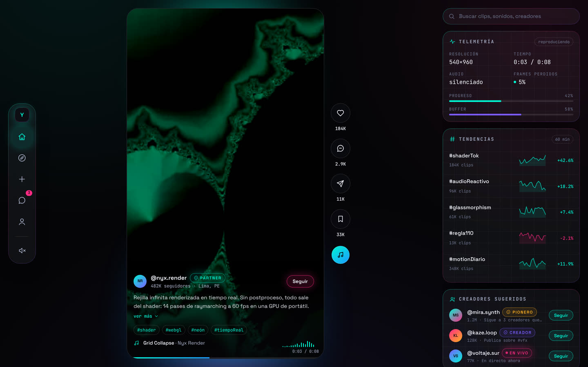
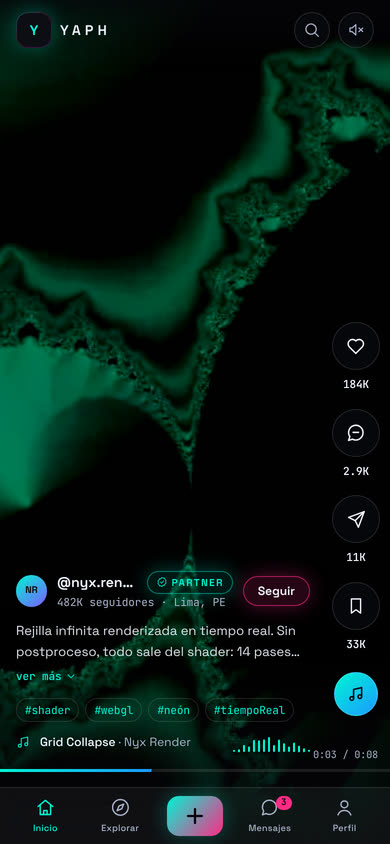
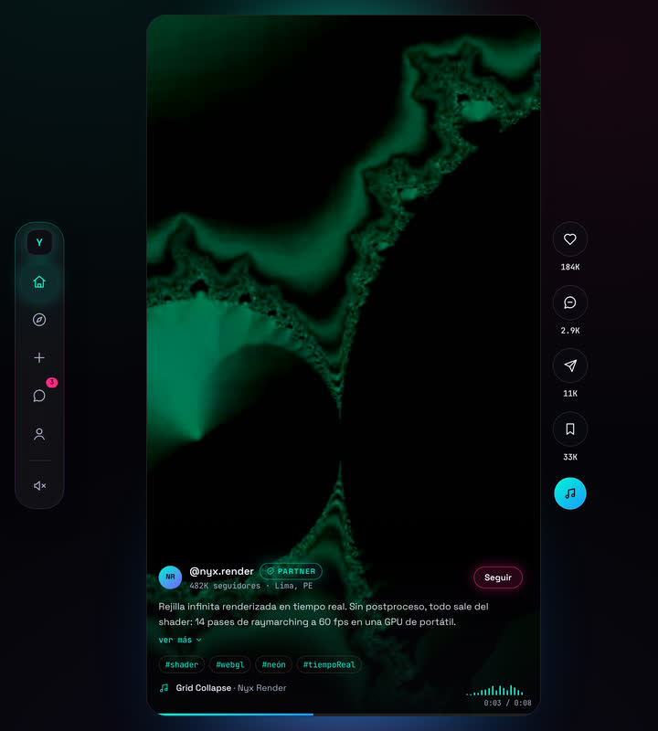
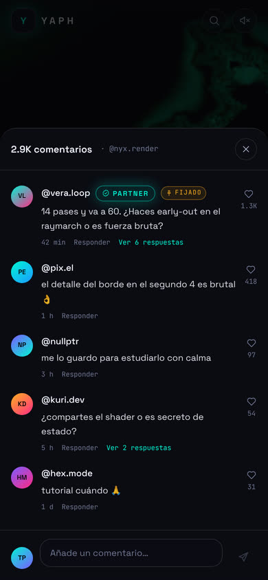
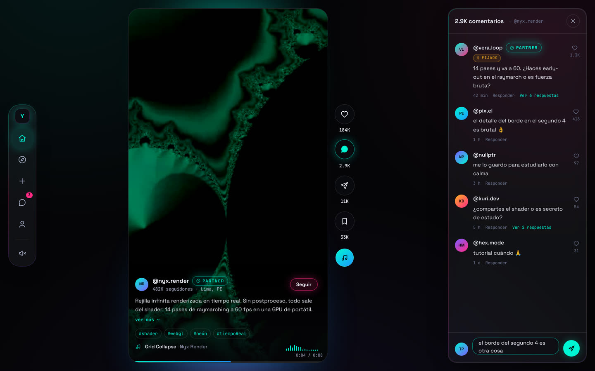

# YAPH

Feed de videos cortos en vertical (formato 9:16, estilo TikTok) con interfaz
oscura, glassmorphism y acentos neón. Angular 22 + Tailwind CSS v4, zoneless y
totalmente basado en signals.



<p align="center">
  
  &nbsp;
  
  &nbsp;
  
</p>

El icono de mensaje abre el hilo del clip con su caja de escritura: en la
columna derecha cuando la hay, como hoja inferior modal cuando no.



---

## Puesta en marcha

Angular 22 exige Node `^22.22.3 || ^24.15.0 || >=26`. Hay un `.nvmrc`:

```bash
nvm use            # Node 24
npm ci
npm start          # http://localhost:4200
```

| Comando          | Qué hace                              |
| ---------------- | ------------------------------------- |
| `npm start`      | Servidor de desarrollo                |
| `npm run build`  | Build de producción (`dist/yaph-app`) |
| `npm test`       | Vitest + jsdom                        |
| `npm run format` | Prettier sobre todo el repositorio    |

---

## Estructura

```
src/app/
├── core/
│   ├── models/feed.ts            Modelo de dominio (todo readonly)
│   ├── data/                     mock-feed.ts y mock-comments.ts — el seam
│   │                             hacia el API real
│   ├── state/
│   │   ├── feed-store.ts         Clip activo, likes, guardados, ventana de montaje
│   │   ├── comments-store.ts     Hilo del clip, publicación y panel abierto
│   │   ├── trends-store.ts       Tendencias y stream simulado de directos
│   │   ├── playback-telemetry-store.ts   Telemetría real del <video> activo
│   │   ├── reduced-motion.ts     prefers-reduced-motion como signal
│   │   └── viewport.ts           Si la ventana tiene columna derecha
│   ├── directives/in-view.ts     IntersectionObserver → clip activo
│   └── util/                     format, noise (PRNG con semilla), media
├── ui/                           Icon, AvatarOrb, HoloBadge, Soundwave,
│                                 HudCard, Sparkline, pipes de métricas
├── layout/                       AppShell, NavDock, MobileTabBar, MobileTopBar
└── features/
    ├── feed/                     FeedPage, VideoStage, ClipOverlay, InteractionRail
    ├── comments/                 CommentsThread (hilo + composer) y CommentsSheet
    ├── trends/                   HudPanel + tarjetas de telemetría/tendencias/
    │                             creadores/comentarios de directo
    └── stub/                     Placeholder de las rutas aún no implementadas
```

Rutas: `/` (feed, en el bundle inicial) y `/explorar`, `/crear`, `/mensajes`,
`/perfil` por `loadComponent`. Build de producción: **~85 kB transferidos** en
el arranque.

---

## Sistema de diseño

Todo vive en `src/styles.css` como tokens de `@theme`, así que Tailwind genera
las utilidades (`bg-void`, `text-neon-cyan`, `shadow-neon-cyan`, `rounded-stage`).

| Token                                        | Valor                 | Uso                                              |
| -------------------------------------------- | --------------------- | ------------------------------------------------ |
| `--color-abyss` / `--color-void`             | `#050508` / `#07070A` | Fondo de página y capas                          |
| `--color-neon-cyan`                          | `#00F5D4`             | Acento primario, estado activo                   |
| `--color-neon-magenta`                       | `#FF2A85`             | Me gusta, directo, deltas negativos              |
| `--color-neon-violet` / `--color-neon-amber` | `#7C5CFF` / `#FFB020` | Acentos secundarios                              |
| `--font-display`                             | Space Grotesk         | Interfaz                                         |
| `--font-mono`                                | JetBrains Mono        | Todas las métricas (`.metric`, cifras tabulares) |

Utilidades propias: `glass` (desenfoque real), `glass-flat` (translúcido sin
desenfoque), `edge-gradient` + `edge-live` (borde degradado que se ilumina en
hover), `hud-grid`, `metric`, `scrollbar-none`.

---

## Decisiones que no se ven en la captura

**`backdrop-filter` nunca sobre el video.** Es la trampa del brief. Desenfocar
el fondo de una capa que se solapa con un `<video>` en reproducción obliga al
compositor a releer el frame en cada repintado; en un móvil de gama media eso
son fotogramas perdidos constantes. El dock y el panel HUD sí usan `glass`
(viven sobre el fondo estático de la página); todo lo que va encima del video
usa un degradado opaco (`.scrim`) o `glass-flat`. La tarjeta de telemetría
muestra el ratio de fotogramas descartados justamente para poder comprobarlo.

**Ventana de montaje de 3 clips.** Un `<video>` es un decodificador. Con el feed
entero montado, el navegador empieza a reciclar decodificadores a media lista y
los clips se quedan en negro. Solo existen en el DOM el clip activo y sus
vecinos (`FeedStore.shouldMount`), con `preload="auto"` en el activo y
`"metadata"` en los vecinos.

**El clip activo lo decide `IntersectionObserver`, no `scrollTop`.** Leer la
posición de scroll en cada evento fuerza un reflujo sincrónico por evento y es
la causa clásica del scroll a tirones en este tipo de feed.

**El resplandor ambiental viene de metadatos, no de muestrear el frame.** Un
sampler con `canvas.drawImage` exige media servido con CORS, cuesta CPU en cada
frame y deja de funcionar en cuanto el video llega por HLS cifrado. Cada clip
trae su par de colores en `accent`, resuelto en ingesta.

**Comentarios del clip y comentarios de directo son cosas distintas.** El
icono de mensaje del rail abre el hilo del clip, con su caja de escritura. La
tarjeta «Comentarios en vivo» del HUD es del directo y solo se monta cuando
quien publica está emitiendo (`creator.badge === 'live'`); al desmontarse se
para también su temporizador, así que no hay trabajo de fondo viendo clips
grabados.

**El hilo reutiliza la columna derecha en vez de abrir una cuarta.** El marco
de video está limitado por la altura, así que conmutar el contenido de esa
columna no cambia ni un píxel del reproductor: abrir comentarios no provoca
reflujo ni recodificación de capas. Donde no hay columna derecha, el hilo se
presenta como hoja inferior.

**La hoja móvil es un `<dialog>` nativo con `showModal()`.** El navegador
aporta el atrapado de foco, el cierre con Escape, el fondo inerte y el
`::backdrop`; reimplementar eso a mano es la fuente habitual de diálogos
inaccesibles. El `::backdrop` es color plano, sin `backdrop-filter`, porque
cubre el video en reproducción.

**La antigüedad de un comentario viaja como minutos, no como fecha.** Así el
formateo es una función pura, el pipe que la envuelve es puro de verdad y
ningún test depende de la hora a la que se ejecute.

**El visualizador de audio dibuja una envolvente precalculada.** Un
`AnalyserNode` por clip obligaría a crear el `AudioContext` tras un gesto del
usuario y a re-enrutar el audio del `<video>` por el grafo. La animación CSS se
pausa de verdad con el video (`animation-play-state`).

**Barras de progreso con `scaleX`, nunca con `width`.** `timeupdate` dispara
cuatro veces por segundo; animar `width` haría layout en cada una.

**El feed arranca silenciado.** Todos los navegadores rechazan el autoplay con
audio sin gesto previo, y un `play()` rechazado deja el feed congelado en el
primer clip. El rechazo se captura y se distingue `AbortError` (normal al pasar
de clip rápido) de `NotAllowedError` (política de autoplay).

**Doble contenedor por clip.** Cada clip se publica en MP4 (H.264/AAC) y WebM
(VP9/Opus), y `pickPlayableSource` elige con `canPlayType` declarando los
`codecs=`. Sin esto, los builds de Chromium sin códecs propietarios — y algunas
compilaciones de Firefox en Linux — se quedan en la portada. La elección se hace
en TS y no con varios `<source>` porque el elemento de media **no** emite
`error` cuando se agotan los `<source>`, y sin ese evento no hay estado de fallo
que mostrar.

---

## Accesibilidad

- Patrón ARIA `feed`: `role="feed"` en el contenedor, `role="article"` con
  `aria-posinset`/`aria-setsize` en cada clip.
- Teclado: `↑`/`↓`, `PageUp`/`PageDown`, `Inicio`/`Fin`, `Espacio` para
  pausar, `M` para el audio. Enlace «Saltar al contenido».
- El control de reproducción es un `<button>` a pantalla completa con etiqueta:
  objetivo táctil grande y, de paso, el control de pausa que pide WCAG 2.2.2
  para contenido que arranca solo.
- `aria-pressed` en los controles con estado (me gusta, guardar, seguir,
  silenciar); `aria-expanded` + `aria-controls` en la descripción colapsable.
- El botón de comentarios declara `aria-haspopup="dialog"` y `aria-expanded`.
  El panel de escritorio no es modal, así que devuelve el foco al botón que
  lo abrió al cerrarse; la hoja móvil lo hace el propio `<dialog>`.
- La caja de escritura solo recibe el foco al abrir cuando hay teclado
  físico: en un móvil levantaría el teclado virtual sobre el hilo que se
  quiere leer.
- `prefers-reduced-motion` desactiva las animaciones decorativas **y** el
  autoplay (`FeedStore.paused` arranca en el valor de la preferencia, de modo
  que el botón de play sigue funcionando). También se respetan
  `prefers-reduced-transparency` y `prefers-contrast`.
- El color nunca es el único indicador: los deltas de tendencia llevan signo
  además de color.
- Anillo de foco visible sobre fondo oscuro en todos los controles.

---

## Datos y clips de demostración

`MOCK_CLIPS` es el único punto que consumen los stores; sustituirlo por un
`resource()` contra el API real no toca la UI.

Los clips son procedurales, generados con fuentes `lavfi` de ffmpeg y
versionados en `public/clips/` (1,8 MB en MP4 + 1,6 MB en WebM) para que la demo
no dependa de la red — los buckets públicos de video de muestra de Google
responden `403` desde hace tiempo. Para regenerarlos:

```bash
./scripts/gen-clips.sh public/clips    # requiere ffmpeg con libx264 y libvpx-vp9
```

---

## Limitaciones conocidas

- **Las tipografías se cargan desde Google Fonts.** En producción conviene
  autoalojar los `.woff2`: elimina una petición de tercero bloqueante del render
  y una dependencia de privacidad. El stack de respaldo ya cubre el fallo.
- **La descripción decide si es colapsable por longitud de texto**, no midiendo
  el alto real. Un `ResizeObserver` por clip visible no paga su coste para
  decidir si mostrar un enlace; el umbral falla como mucho en una línea.
- **Comentarios, tendencias y creadores son datos simulados.** Solo la
  telemetría de reproducción es real. El hilo no pagina ni admite respuestas
  («Responder» y «Ver N respuestas» son los enganches, sin lógica detrás), y
  lo publicado vive en memoria: se pierde al recargar.
- **La caja de escritura usa un signal, no Signal Forms.** Es un campo de
  texto libre con un límite de longitud: sin esquema, campos cruzados ni
  envío asíncrono, `@angular/forms/signals` no aportaría nada. Cuando el
  composer gane menciones, respuestas y adjuntos, ahí sí toca migrarlo.
- **Sin SSR.** Para un feed público de video el SEO importa, pero `@angular/ssr`
  obligaría a guardar todos los accesos a `IntersectionObserver`,
  `HTMLVideoElement` y `matchMedia`. Es la siguiente pieza natural, no un olvido.
- **Un solo nivel de calidad por clip.** Un feed real necesita HLS/DASH con
  varias representaciones; eso vive en una capa de reproductor, no en este
  componente.
